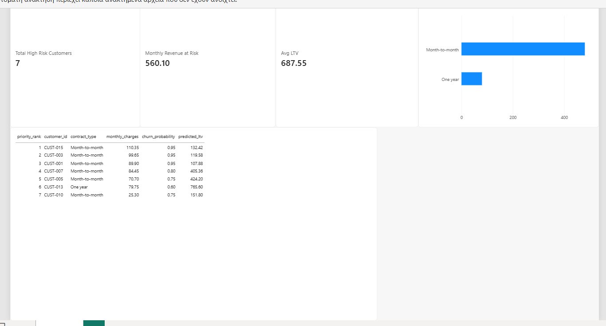

# Customer Retention Engine

End-to-end σύστημα που αναλύει δεδομένα συνδρομητών, υπολογίζει την **πιθανότητα αποχώρησης (Churn Probability)** και την **αναμενόμενη αξία πελάτη (Predicted LTV)** σε Java, αποθηκεύει τα αποτελέσματα σε SQL βάση και τα παρουσιάζει σε Power BI Dashboard.

## Αρχιτεκτονική

```
 sql/02_sample_data.sql          ┌────────────────────┐
 (πελάτες χωρίς scores) ───────► │  SQLite (customers) │
                                 └─────────┬──────────┘
                                   SELECT  │  ▲ UPDATE (churn_probability,
                                           ▼  │          risk_level, predicted_ltv)
                                 ┌────────────────────┐
                                 │ Java: Main         │
                                 │  └ ChurnService    │  business logic
                                 └─────────┬──────────┘
                                           │ views (03_analytics_views.sql) + CSV export
                                           ▼
                                 ┌────────────────────┐
                                 │ Power BI Dashboard │  DAX measures
                                 └────────────────────┘
```

| Layer | Τεχνολογία | Αρχεία |
|---|---|---|
| Database | SQLite | `sql/01_schema.sql`, `02_sample_data.sql`, `03_analytics_views.sql` |
| Backend | Java 17, Maven, sqlite-jdbc | `src/main/java/com/retention/...` |
| BI | Power BI Desktop, DAX | `powerbi/` |

## Business Logic

**Churn Probability** = 10% βάση + επιβαρύνσεις, με ανώτατο όριο 95%:

| Χαρακτηριστικό | Επιβάρυνση |
|---|---|
| Συμβόλαιο Month-to-month | +35% |
| Internet Fiber optic | +20% |
| Χωρίς Tech Support | +15% |
| Tenure < 12 μήνες | +15% |

**Risk Level:** High Risk ≥ 60%, Medium Risk 35%–59%, Low Risk < 35%.

**Predicted LTV (€)** = `monthly_charges × (1 − churn_probability) × 24`

## SQL Views

- `vw_revenue_at_risk`: μηνιαία έσοδα (και αναμενόμενη απώλεια) των High Risk πελατών ανά `contract_type`.
- `vw_retention_priority`: κατάταξη High Risk πελατών με `DENSE_RANK() OVER (ORDER BY monthly_charges * churn_probability DESC)`.

## How to run

Προαπαιτούμενα: JDK 17+, Maven 3.8+.

```bash
git clone <repo-url>
cd customer-retention-engine

# Μεταγλώττιση + εκτέλεση
mvn compile exec:java -Dexec.args="retention.sqlite sql powerbi"
```

Παράμετροι (προαιρετικές): `[dbPath] [sqlDir] [csvOutDir]` — προεπιλογές `retention.sqlite`, `sql`, `powerbi`.

Την πρώτη φορά (όταν δεν υπάρχει το αρχείο βάσης) το `Main` εκτελεί αυτόματα τα τρία SQL scripts. Στη συνέχεια:

1. διαβάζει τους πελάτες από τη βάση,
2. υπολογίζει churn probability, risk level και predicted LTV μέσω `ChurnService`,
3. κάνει `UPDATE` στον πίνακα `customers`,
4. εξάγει `customers.csv`, `vw_revenue_at_risk.csv`, `vw_retention_priority.csv` στο `powerbi/`.

Για επανεκκίνηση από την αρχή διέγραψε το `retention.sqlite`.

Ερωτήματα πάνω στη βάση (π.χ. με την `sqlite3` CLI):

```bash
sqlite3 retention.sqlite "SELECT * FROM vw_retention_priority;"
```

## Power BI Dashboard

Οδηγίες σύνδεσης, DAX measures και σχεδιασμού των visuals: [`powerbi/README.md`](powerbi/README.md).



> Πρόσθεσε το screenshot του dashboard ως `powerbi/dashboard.png`.

## Δομή

```
customer-retention-engine/
├── pom.xml
├── README.md
├── .gitignore
├── sql/
│   ├── 01_schema.sql
│   ├── 02_sample_data.sql
│   └── 03_analytics_views.sql
├── src/main/java/com/retention/
│   ├── Main.java
│   ├── model/Customer.java
│   └── service/ChurnService.java
└── powerbi/
    ├── README.md
    └── Retention_Dashboard.pbix   (δημιουργείται στο Power BI Desktop)
```
